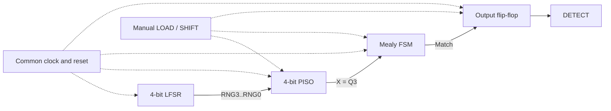
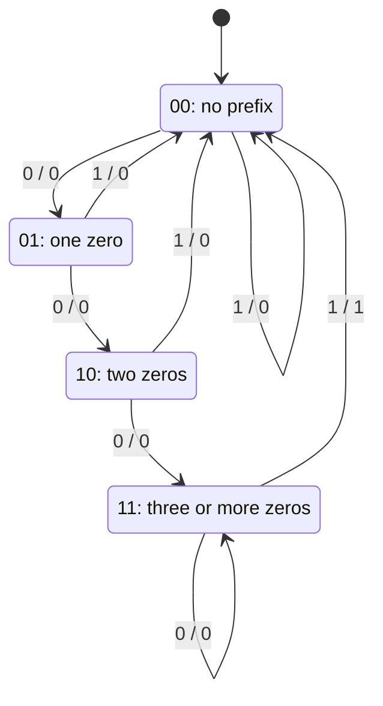

# Synchronous Digital Pattern Detection System | 0001

**4-bit LFSR · 4-bit PISO · Mealy FSM · 74LS-series TTL · Custom PCB**

A gate-level synchronous digital system that generates deterministic pseudorandom binary words, serializes them, and detects the sequence `0001` in the accepted serial stream. The design integrates 74LS-series logic ICs and D flip-flops using a shared rising-edge clock, with a registered detection output and an EasyEDA PCB layout.

Developed as a group academic project for **IE3004 – Digital Systems Design (2026)**, Department of Computer Systems Engineering, Faculty of Computing, Sri Lanka Institute of Information Technology (SLIIT).

<!-- The three image references will render after the original PNG exports are uploaded to assets/. -->


## Key features

- Four-bit linear feedback shift register (LFSR), initialized to `0001`, with a 15-state nonzero cycle.
- Four-bit parallel-in serial-out (PISO) register with manual load/shift selection and MSB-first transmission.
- Four-state, two-bit Mealy sequence detector with a registered one-clock detection pulse.
- Shared positive-edge clock and active-low asynchronous reset.
- State retention during loading, permitting matches across word boundaries.
- Gate-level design using 14 TTL logic IC packages, LED indicators and a routed two-layer PCB design.

## System architecture



| Subsystem | Function |
| --- | --- |
| Pseudorandom generator | Produces a sequence of 4-bit words using XOR feedback. |
| PISO shift register | Captures a generator word in parallel and transmits it one bit per shift edge. |
| Pattern detector | Tracks trailing zeros and recognizes `0001` when a one completes the prefix. |
| Registered output | Captures the match on the rising edge and clears on the next edge. |

## 1. Pseudorandom number generator

The four-bit LFSR uses feedback `RNG3 XOR RNG2`. Reset initializes the register to `0001`, avoiding the all-zero lockup state. It advances on every rising clock edge, independent of LOAD.

```text
0001 → 0010 → 0100 → 1001 → 0011 → 0110 → 1101 → 1010
     → 0101 → 1011 → 0111 → 1111 → 1110 → 1100 → 1000 → 0001
```

## 2. PISO shift register

When `LOAD = 1`, the PISO captures all four generator bits on a rising edge. When `LOAD = 0`, it shifts toward Q3 and inserts zero at Q0. The FSM accepts the pre-edge Q3 bit, MSB first. LOAD pauses FSM state progression; it does not stop the generator.

## 3. 0001 sequence detector

The detector uses two state bits, A and B, to encode the length of the matching zero prefix. A one received after at least three zeros completes the target pattern.



Labels are `serial bit / match` during SHIFT. The match is captured by a separate output flip-flop, rather than exposed as an unregistered Mealy output.

| Current AB | Next AB, X=0 | Next AB, X=1 | Match, X=1 |
| --- | --- | --- | --- |
| 00 | 01 | 00 | 0 |
| 01 | 10 | 00 | 0 |
| 10 | 11 | 00 | 0 |
| 11 | 11 | 00 | 1 |

## Hardware design

| IC | Function | Quantity |
| --- | --- | ---: |
| 74LS74 | Dual D flip-flop with preset and clear | 6 |
| 74LS08 | Quad 2-input AND gate | 4 |
| 74LS32 | Quad 2-input OR gate | 2 |
| 74LS04 | Hex inverter | 1 |
| 74LS86 | Quad 2-input XOR gate | 1 |
| **Total** | **Logic IC packages** | **14** |

### Circuit schematic

[](assets/schematic.png)

### Two-layer PCB routing

[](assets/pcb-layout.png)

The PCB export includes through-hole DIP logic packages, top and bottom copper routing, indicator LEDs, control switches, and power/clock connectors. The 3D model above is a CAD visualization, not a photograph of manufactured hardware.

## Functional verification

The expected integrated test begins with reset, then captures `0001` in the PISO on a single load edge before accepting four serial bits.

| Event | Accepted X | PISO after edge | AB after edge | Logical DETECT |
| --- | --- | --- | --- | --- |
| Load | — | 0001 | 00 | 0 |
| Shift 1 | 0 | 0010 | 01 | 0 |
| Shift 2 | 0 | 0100 | 10 | 0 |
| Shift 3 | 0 | 1000 | 11 | 0 |
| Shift 4 | 1 | 0000 | 00 | **1** |
| Next load | — | New word | 00 | 0 |

The tables describe expected logical behavior, not measured hardware waveforms. An independent Python reference model is included to check the logic and integrated timing at an abstract clock-edge level:

```bash
python -m unittest discover -s verification -v
```

See the [verification guide](docs/verification.md) for reproducible tests, expected results and evidence requirements.

## Tools and engineering skills

| Tools | Application |
| --- | --- |
| Proteus | Gate-level simulation workflow described in the project working guide |
| EasyEDA | Schematic capture, PCB placement/routing and 3D visualization |
| Python 3 | Supplemental executable behavioral model and unit tests |

**Engineering concepts:** synchronous sequential logic, FSM design, Boolean simplification, LFSRs, shift registers, clock-edge timing, digital circuit integration, schematic capture, PCB layout and functional verification.

## Design limitations and future improvements

- LOAD is manual; there is no automatic four-bit transfer controller or empty/data-valid flag. Extra shift clocks introduce zero bits that the FSM accepts.
- The LFSR is deterministic and cannot produce `0000` from its nonzero seed; it is not a cryptographic random source.
- A fixed one-load/four-shift schedule samples only three of the 15 LFSR states. Varying load intervals can change the sampled words.
- Before fabrication, review decoupling, unused logic inputs, indicator current, clock fanout, reset/switch timing, ERC/DRC and PCB manufacturing files.

Future revisions could add an automatic load/shift controller, a data-valid signal, more robust hardware conditioning and measured waveform documentation.

## Repository contents

| Location | Contents |
| --- | --- |
| [assets/](assets/) | Original schematic, 2D routing and 3D PCB exports |
| [docs/design.md](docs/design.md) | Architecture, Boolean equations, K-maps and IC mapping |
| [docs/verification.md](docs/verification.md) | Test procedures, expected results and hardware review |
| [docs/bom.csv](docs/bom.csv) | Schematic-derived component list |
| [verification/](verification/) | Supplemental Python model and automated tests |
| [design-files/](design-files/) | Instructions for adding editable CAD and simulation files |

## Project status and attribution

The supplied materials document the gate-level design, simulation workflow and PCB design exports. Native CAD/simulation files, measured waveforms and photographs of a physical prototype are not included in this repository snapshot. The Python model verifies the documented equations only; it does not validate the actual routed board or replace Proteus simulation.

This is a group academic project. Credit all contributors and confirm publication permission before making the repository public. No open-source license has been selected; reuse rights should be clarified with the contributors.

## References

- IE3004 Digital Systems Design, Digital Pattern Detection System Design assignment (SLIIT, 2026; course brief).
- Circuit-specific 0001 pattern detector working guide (October 2026; project documentation).
- [Texas Instruments SN74LS74A datasheet](https://www.ti.com/lit/ds/symlink/sn74ls74a.pdf)
- [Texas Instruments SN74LS86A datasheet](https://www.ti.com/lit/ds/symlink/sn74ls86a.pdf)
